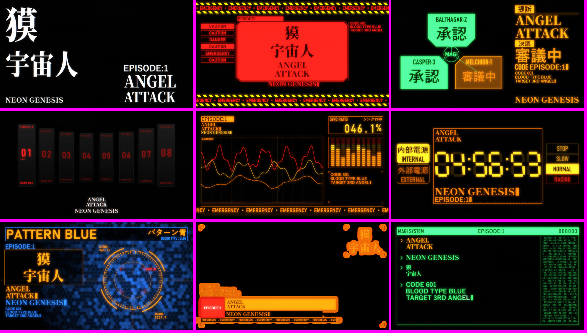
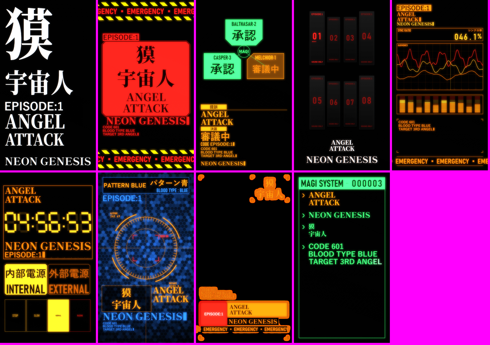
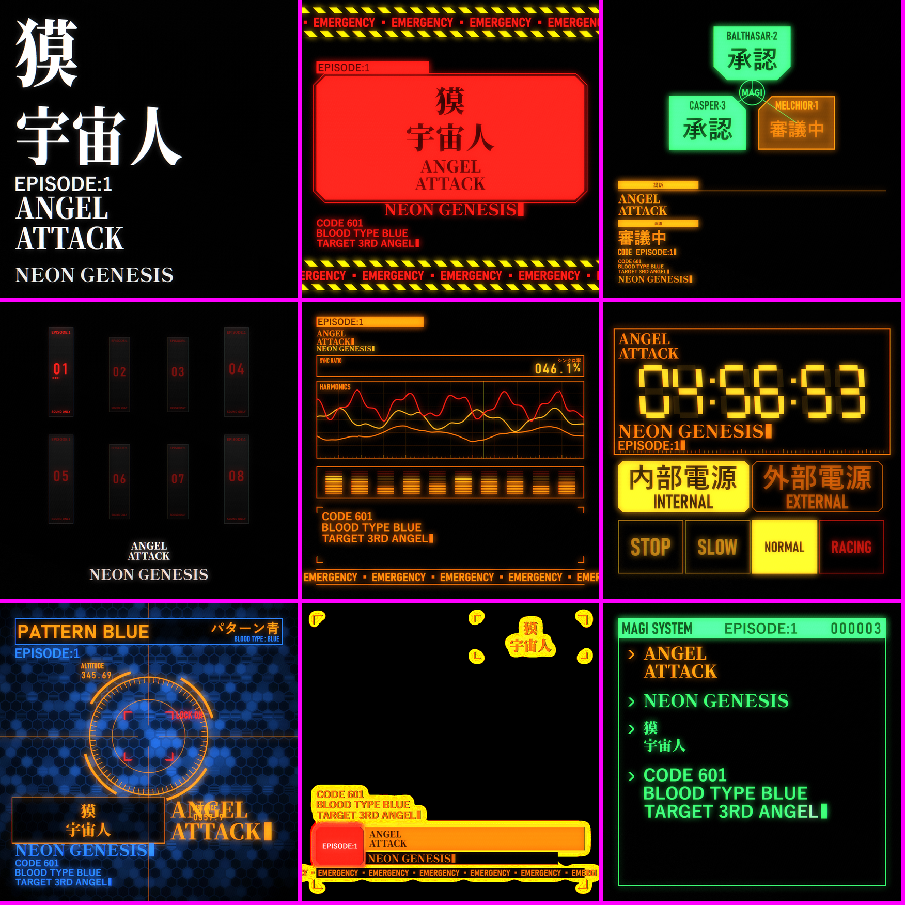

# EVA Overlay for Resolume

A Resolume Wire source that lays out your text like the interface screens of an Evangelion-style
anime: title cards, alerts, MAGI, SOUND ONLY, sync ratio, countdown, Pattern Blue, a lower
third and a terminal. You type six text fields in Arena. The shader measures the rendered
lines and lays them out again in nine animated presets. It works in landscape, portrait,
square and ultra-wide outputs.



| Portrait 1080×1920 | Square 1080×1080 |
|---|---|
|  |  |

## Install (Windows)

1. Download `EVA-Responsive-<version>.zip` from [Releases](../../releases) and unzip it.
2. Right-click `install.ps1` > **Run with PowerShell**, or run:
   ```
   powershell -ExecutionPolicy Bypass -File install.ps1
   ```
   The script installs two fonts for the current user and copies the patch to
   `Documents\Resolume Wire\Patches\EVA-Responsive`. Use `-PatchesDir <folder>` if your
   Wire patches are somewhere else.
3. Restart Resolume Wire and Arena. New fonts only show after a restart.
4. In Arena, add **EVA-Responsive** from the Wire sources to a clip. It takes the size of the
   composition.

Needs Resolume Arena 7.23 or later with Wire. Yu Gothic and Bahnschrift come with Windows.

## Text fields

| Field | Font | Use |
|---|---|---|
| Titre | Noto Serif CJK JP Black, 4K render | main title |
| Sous-titre | Shippori Mincho B1 ExtraBold | second line |
| Kanji | Noto Serif CJK JP Black, 4K render | big Japanese block (獏 / 宇宙人) |
| Label | Yu Gothic Bold | tag, code, EPISODE:1 |
| Infos | Yu Gothic Bold | data lines, up to 6 |
| Bandeau | Bahnschrift Bold Condensed (Latin only) | scrolling ticker |

Type ` / ` to break a line. A field can hold at most 6 lines. An empty field is skipped, and
the layout gives its space to the others. In some presets, an empty field shows a default
interface word instead (警告, WARNING, 使徒, SEELE...).

The dashboard labels are in French.

## Presets

0 Carte titre · 1 Alerte · 2 MAGI · 3 Sound Only · 4 Synchro · 5 Activité (7-segment
countdown, "Compte à rebours") · 6 Pattern Blue · 7 Bandeau (lower third, transparent)
· 8 Terminal (all fields typed in sequence).

- **Défilement**: Fixe, Auto (in order from the chosen preset), or Aléatoire. **Durée** is in
  seconds, or in beats when **Horloge** is set to Temps.
- **Transition**: Coupe, Flash, Signal, or Volet. The outgoing preset plays its exit
  animation, then the cut happens.
- **Recommencer** restarts the current preset from its intro.
- **Fond**: transparent or black. On a transparent background the glow stays a light halo.

## How the typography stays intact

The first passes measure each Text Render on a 480 × 270 grid. They find the ink rows, the
lines (split on 5 or more empty rows), and the glyph index of each column. The layout then
places each line on its own: it fits the box, or justifies it like a title card where every
line is as wide as the box. The animations reveal whole glyphs only: Frappe, Décodage,
Balayage, Clignotement. No letter is ever cut, and no letter is distorted except by a uniform
scale or the Étirement setting.

The preset state (preset, start time, text hash) is stored as exact bytes in an 8-bit target.
A half-float target would round the times and break the clock after about 30 minutes.

## Live performance

- The measurement passes are persistent. They only run again when a text length changes (for
  6 frames), plus a refresh every 30 frames. The rest of the time they copy their last result.
- The glow passes are skipped when Lueur = 0.
- Measured in Wire at 1080p: about 10 to 37 % GPU, depending on the preset.

## Build from source

Python 3.10+. Put the two fonts in `fonts/` first (see [fonts/README.md](fonts/README.md)).

| File | Role |
|---|---|
| `EVA_Responsive.isf` | the multipass shader (text measurement, layout, presets, glow, composite) |
| `build_atlas.py` | draws the fixed interface words (MAGI, SOUND ONLY, 警告, digits...) into `eva_atlas.png` and writes their rectangles into the shader (`// ATLAS BEGIN/END`). Needs Pillow. |
| `build_wire.py` | writes `EVA-Responsive.wire` from `template/base.wire` and copies the shader and the atlas next to it. Standard library only. |
| `banc.html` | WebGL2 bench of the shader, with the same text fields |
| `shoot.py` | drives the bench in Chrome to take stills (`python shoot.py stills 1080 1920`) or render `reel.json` (`python shoot.py reel`). Needs Playwright and ffmpeg. |
| `release.py` | builds `dist/EVA-Responsive-<version>.zip` |

```
python build_atlas.py      # only when the atlas words change
python build_wire.py       # writes to Documents/Resolume Wire/Patches/EVA-Responsive
```

Never save the patch from Wire. Arena finds it by its identifier (uuid5 of
`vj/wire/EVA-Responsive`), which `build_wire.py` always writes. `shoot.py` runs Chrome with
ANGLE on OpenGL, because the D3D backend takes minutes to compile the shader.

## License

Code: MIT. Fonts: SIL Open Font License 1.1 (see `fonts/`).

This is a fan-made tool. It is not affiliated with or endorsed by khara, Gainax or the owners
of Neon Genesis Evangelion. It ships no artwork or logos from the series.
